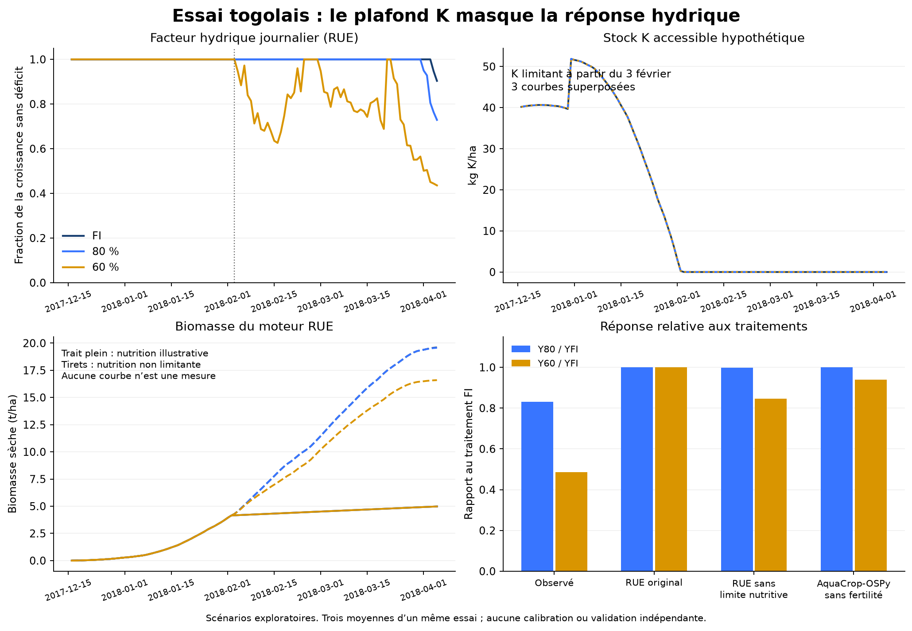

# Togo : diagnostic causal du plateau et benchmark mécaniste

## Résultat

Le plateau n'est pas une absence de calcul de l'eau. Avec les fournitures illustratives actuelles, K borne la biomasse **avant** que les traitements hydriques divergent. Changer l'eau ne peut alors modifier le grain calculé. Ce régime est démontré sur le moteur, pas observé dans les sols de l'essai.

Le correctif ajoute le bilan journalier complet, l'export CSV dans l'application, les plafonds nutritifs calculés et des contrôles de conservation. Il ne remplace pas K par une fourniture inventée, ne change pas HI par traitement et ne présente pas un profil comme calibré. Le benchmark AquaCrop-OSPy est exécuté et versionné, en recherche et en CI, sans activation de ce comparateur comme moteur de l'application.



## Version et protocole

Départ : `40d1884`, puis correctifs logiciels de la [PR #53](https://github.com/fawitchamie-ai/agri/pull/53), fusion `1dceedd95c93135509890f26989ba69a133d2578`. [Publication 42812701783](https://github.com/fawitchamie-ai/agri/actions/runs/42812701783) et santé réussies. L'identité directe `/api/version` retourne ce SHA. Les trois scénarios ont ensuite répondu HTTP 200 sur le service publié : 2 574,189655 kg/ha chacun, K limitant 62 jours. Le masque terrestre du serveur donne 841,505 m², distinct du masque synthétique local de 12 142 m² : production 216,619 kg, calculée sur la surface effectivement autorisée. Ce contour n'est pas celui des parcelles expérimentales.

La présente branche ajoute l'instrumentation `daily-rue-npk-1.2.0`. Les preuves de sa publication figurent dans la description de sa PR, mise à jour après déploiement. Les campagnes et les styles existants sont conservés.

Le protocole principal a été écrit avant les expériences, sans optimisation des récoltes (`PROTOCOL.md`, empreinte conservée). Cinq calendriers, tous hypothétiques, gardent exactement les cumuls par stade du tableau 4 : quotidien ; tous les trois jours en début/fin d'intervalle ; tous les sept jours en début/fin d'intervalle. Ils partagent les dates de base entre traitements. Les variantes de représentation du comparateur sont détaillées dans `AQUACROP_ADAPTER.md`. Aucun calendrier n'est choisi en fonction de sa RMSE. `PROTOCOL_NOTES.md` précise un écart de mise en œuvre : C/D utilisent un remplissage quotidien explicite plutôt que le déclenchement automatique annoncé ; le protocole original est conservé.

## Preuve du plafond

Le vrai moteur fournit, pour le scénario original :

\[
K_{fourni}=40+111\times0,2+200\times0,15\times0,83\times0,5
=74,6515\ \mathrm{kg\ K/ha}.
\]

0,83 est la conversion K₂O vers K déjà utilisée dans le dépôt ; 0,5 est la récupération illustrative. Les masses sont élémentaires, pas des teneurs de sol. Avec une demande de 15 kg K/t de biomasse sèche :

\[
B_{max,K}=74,6515/15=4,976767\ \mathrm{t/ha},\qquad
Y=B\times0,45/(1-0,13)=2,574190\ \mathrm{t/ha}.
\]

Le bilan final retrouve ce plafond à l'erreur flottante près ; K restant = 0. Les résidus eau/NPK sont contrôlés quotidiennement. L'azote total, le P extractible, le pH et la CEC ne sont pas convertis en fournitures absorbables.

| Calendrier | Traitement | Première divergence de facteur eau avec FI | Première divergence de biomasse | Dernier jour de biomasse différente | Premier K limitant |
|---|---|---|---|---|---|
| Quotidien | 80% | 01/04/2018 | Aucune | Aucun | 03/02 |
| Quotidien | 60% | 04/02/2018 | Aucune | Aucun | 03/02 |
| Impulsions 3 j, début | 60% | 31/01 | 31/01 | 02/02 | 03/02 |
| Impulsions 7 j, début | 60% | 23/01 | 23/01 | 04/02 | 05/02 |

Les impulsions peuvent créer des divergences transitoires : jusqu'à 269,38 kg/ha de biomasse d'écart dans l'exemple à sept jours. Ensuite, les trois trajectoires consomment le même K total et convergent. Sous calendrier quotidien, le blocage K commence la veille du premier déficit différentiel de 60% : la biomasse ne diverge même pas.

## Contrôle hydrique

Les apports du replay sont déclarés comme forçages de scénario, jamais importés comme observations réelles. Efficacité d'application 100% et transport 100% sont des hypothèses explicites du diagnostic. Des tests séparés vérifient 10 mm au champ × 50% = 5 mm nets, et 10 mm à la source × 80% × 50% = 4 mm nets, sans deuxième perte.

| Stade du tableau 4 | ETc publiée (mm) | Demande reconstituée NASA/Kc (mm) |
|---|---:|---:|
| Initial, 20 j | 82,4 | 63,750 |
| Développement, 30 j | 203,7 | 172,732 |
| Mi-saison, 46 j | 385,8 | 414,231 |
| Fin, 15 j | 83,3 | 106,378 |
| Total | **755,2** | **757,091** |

L'écart total n'est que +1,891 mm (+0,25%), mais masque des écarts par stade. Causes de représentation : météo de maille NASA plutôt que station, Kc interpolés quotidiennement et durées du tableau 4 différentes de celles de la description Kc. Aucune multiplication destinée à retrouver le rendement n'est appliquée.

Avec le calendrier quotidien, ET réelle = 756,072 / 751,523 / 640,244 mm ; jours freinés par eau = 2 / 5 / 54. Le déficit de 60% est surtout en mi-saison (40 jours) puis en fin de cycle (14). Les cinq calendriers produisent des stress différents : FI 2–44 jours, 80% 5–46, 60% 50–57. Ils ne sont donc pas tous sans stress. Les volumes ne permettent pas d'identifier le vrai calendrier ni la durée réelle des déficits.

Le moteur RUE fait un bilan de la zone racinaire, avec exposition progressive de l'eau initiale des horizons. Son drainage est une sortie de cette zone ; il ne représente pas une redistribution hydrodynamique complète jusqu'à saturation. Le comparateur utilise un profil multicouche avec stockage au-dessus de FC et drainage. Les bilans ne doivent pas être comparés en confondant ces frontières. L'état initial publié au-dessus de FC reste refusé par RUE ; la variante AquaCrop qui le représente possède une saturation dérivée et une loi de drainage explicites, pas une mesure supplémentaire.

## Expériences séparées et réponse aux traitements

Toutes les valeurs de grain ci-dessous sont à 13% d'humidité, hypothèse médiane de la plage publiée 12–14%. Les contrôles B, C et D ne décrivent pas les conditions réelles.

| Expérience, calendrier quotidien | FI (t/ha) | 80% (t/ha) | 60% (t/ha) | Y80/YFI | Y60/YFI |
|---|---:|---:|---:|---:|---:|
| Observations publiées/rapportées | 2,2004 | 1,8309 | 1,0683 | 0,8321 | 0,4855 |
| A : original, eau et nutrition limitables | 2,5742 | 2,5742 | 2,5742 | 1,0000 | 1,0000 |
| B : nutrition synthétique non limitante | 10,1398 | 10,1215 | 8,5830 | 0,9982 | 0,8465 |
| C : eau non limitante, nutrition illustrative | 2,5742 | 2,5742 | 2,5742 | 1,0000 | 1,0000 |
| D : eau et nutrition non limitantes | 10,1429 | 10,1429 | 10,1429 | 1,0000 | 1,0000 |
| AquaCrop-OSPy, eau identique, fertilité non simulée | 11,1073 | 11,1095 | 10,4363 | 1,0002 | 0,9396 |

A est déjà une co-limitation ; D est le contrôle factoriel qui complète B et C. C remplit chaque matin le réservoir sans quota : les gros volumes et leur drainage sont seulement un contrôle d'eau non limitante. Ils ne sont pas une prescription d'irrigation.

Écarts Y80−YFI / Y60−YFI : observés −0,3695 / −1,1321 t/ha ; A 0/0 ; B −0,01835 / −1,55681 ; AquaCrop +0,00219 / −0,67107. L'article ne trouve pas de différence significative entre FI et 80% : aucune séparation statistique forcée n'est exigée.

| Comparaison exploratoire, n=3 moyennes | MAE (t/ha) | RMSE (t/ha) | Biais (t/ha) | nRMSE |
|---|---:|---:|---:|---:|
| A avant/après instrumentation | 0,87432 | 0,99329 | +0,87432 | 58,43% |
| B, sans limitation nutritive | 7,91491 | 7,92126 | +7,91491 | 465,99% |
| AquaCrop, sans stress de fertilité | 9,18450 | 9,18667 | +9,18450 | 540,43% |
| Référence constante 2 t/ha, décrite dans l'article | 0,43373 | 0,55881 | +0,30013 | 32,87% |

La nRMSE divise par la moyenne des trois récoltes, 1,699867 t/ha. Les 36 expériences RUE, les 20 exécutions AquaCrop et les perturbations de paramètres ne sont **pas** des effectifs supplémentaires de validation. Les cinq calendriers gardent le plateau A. Supprimer K pour B change la réponse mais dégrade fortement les valeurs absolues : ni disparition d'un plafond ni meilleur mécanisme ne prouvent une meilleure précision.

## Couvert, biomasse et HI publiés

`published-intermediates.json` transcrit les tableaux 1, 5 et 6, contrôlés sur les pages originales. Les figures 3, 6 et 7 ont été inspectées ; aucune courbe journalière numérisée ni répétition brute n'est inventée. Tableau 6 : biomasse sèche de mi-saison 8,260 / 4,320 / 4,730 t/ha ; stade tardif 7,190 / 7,170 / 3,960 ; couvert de mi-saison 89,39 / 77,26 / 74,31% ; LAI 4,15 / 2,93 / 2,57. Ce sont des moyennes par stade, pas des états journaliers finaux. Les moyennes calendaires simulées sont exportées séparément sans leur attribuer les mêmes poids d'échantillonnage.

RUE emploie le même fAPAR paramétré dans les trois traitements ; fAPAR est une interception du rayonnement, pas le couvert mesuré. Il ne simule pas le ralentissement du couvert, l'évaporation/transpiration séparées ou la formation journalière du grain. Sa biomasse originale finale 4,9768 t/ha et sa moyenne de stade tardif 4,8834 diffèrent du niveau publié. Sans nutrition limitante, la biomasse finale monte à 19,6037 / 19,5682 / 16,5938 : les paramètres ne deviennent pas locaux par cette seule suppression de limitation.

HI est fixé à 0,45, alors que les HI mesurés valent 0,2608 / 0,2541 / 0,2461. L'écart est matériel. Mettre les trois HI observés comme paramètres injecterait les observations dans la prédiction. Un HI commun de 0,26 donnerait environ 1,487 t/ha avec la même biomasse plafonnée, sans corriger les rapports 1/1. Cette opération n'est ni adoptée ni présentée comme calibration : une biomasse erronée ne doit pas être compensée par HI.

## Benchmark AquaCrop reproductible et limites d'identification

AquaCrop-OSPy **3.0.12**, dépendances verrouillées, Python 3.12. C'est un port libre distinct du logiciel officiel FAO, documenté comme ne simulant pas le stress de fertilité. La séquence FAO couvert → transpiration → biomasse → HI sert de référence mécaniste, pas de vérité terrain.

Paramètres : températures 10/30°C, émergence DAP7, sénescence DAP76, floraison DAP54 pendant 10 jours, construction HI 42 jours, HI de référence 0,50 du tableau 1 ; calendrier principal 111 jours observés et variante 100 jours du tableau 1 ; densité 70 000 des méthodes (le tableau 1 mentionne 62 500). CGC est déduit du maximum de couvert à DAP60 avec l'équation de calendrier versionnée ; CCx 0,96 et les autres paramètres conservatifs restent génériques. La variante `daily-default-CGC` conserve le CGC d'origine. Aucun ajustement sur le grain n'est effectué.

La profondeur racinaire est gardée à 0,5 m pour le comparatif ; le port exige un tampon sous les racines, donc les paramètres du dernier horizon sont explicitement prolongés jusqu'à 0,6 m. Saturation = porosité dérivée de la densité apparente avec densité des particules supposée 2650 kg/m³ ; source FAO Soils Portal, statut estimé. La loi de drainage est celle du paquet figé. Le bilan est contrôlé sur **le profil effectivement simulé**, pas sur une épaisseur nominale différente. Résidu maximal des 20 simulations < 1,2×10⁻¹³ mm. La biomasse du port, en g/m², est convertie par ×10 en kg/ha et vérifiée par B×HI = grain sec.

Le port récolte ici le 28 mars, avant le 5 avril observé : 102 jours simulés. Une partie de l'irrigation du calendrier après cette récolte n'est pas appliquée. Les totaux prévus et réellement simulés sont tous deux archivés. Il ne faut pas forcer la sortie de récolte pour consommer artificiellement ces volumes.

Pour le quotidien, transpiration FI/80/60 ≈ 405,69 / 405,80 / 376,79 mm ; les autres flux, le couvert et HI sont exportés. Le modèle ne reproduit pas la perte observée de 60%. Sa fertilité non simulée, ses coefficients génériques, l'incertitude du calendrier et les différences de profil/phenologie empêchent d'attribuer une erreur unique à une seule équation RUE.

**Décision bornée :** la lacune structurelle du RUE (couvert fixe, ET agrégée, HI fixe) est documentée, mais ce benchmark n'établit pas qu'un remplacement précis, paramétré avec ces seules données, corrigerait la réponse observée. Il ne justifie pas l'insertion d'un facteur hydrique ou d'un HI après coup. Le correctif livré expose les flux réels, le plafond et les hypothèses ; aucune nouvelle mécanique locale n'est activée sans paramètres identifiables. AquaCrop n'est pas raccordé comme récolte opérationnelle de substitution.

## Sensibilité, calibration et Sékou

Le contrôle annoncé dans `IDENTIFIABILITY_PROTOCOL.md` multiplie les fournitures/récupérations par q=0,95/1/1,05. Avec HI fixe, Y varie de 2,4455 à 2,7029 t/ha. En divisant simultanément HI par q, les biomasses varient de 4,7279 à 5,2256 t/ha tandis que les trois rendements restent 2,57419. Ce sont des perturbations mathématiques exploratoires, pas des incertitudes mesurées. Plusieurs jeux de paramètres produisent donc le même grain ; régler stocks et HI sur trois récoltes n'identifierait pas un profil réel.

Nombre de paramètres calibrés ici : **zéro**. Aucun traitement n'est qualifié de validation indépendante ; aucune extension aux six pays. Les données futures pourraient contraindre le profil, mais leur arrivée n'est pas une condition aux corrections et expériences déjà livrées.

Sékou reste analysé dans ses propres unités de masses fraîches d'épis. Une masse fraîche de grain identifiée, son humidité Hgrain et une surface représentative A seraient nécessaires pour appliquer Yref(t/ha) = Mgrain_frais(kg) × (1−Hgrain)/(1−Href) × 10/A(m²). La masse ou fraction de grain, son humidité et la représentativité surfacique ne sont pas établies ; aucun taux d'égrenage générique n'est utilisé. L'exclusion du benchmark de grain sec est une exigence de mesure.

## Reproduire et vérifier

```bash
pnpm install --frozen-lockfile
node --experimental-transform-types scripts/togo-causal-diagnostics.mjs
node --experimental-transform-types scripts/togo-identifiability.mjs
python3.12 -m venv .aquacrop-python
.aquacrop-python/bin/python -m pip install -r research-data/togo-causal/2026-11-10/requirements-aquacrop.lock.txt
DEVELOPMENT=DEVELOPMENT .aquacrop-python/bin/python scripts/togo-aquacrop-benchmark.py
.aquacrop-python/bin/python scripts/check-togo-benchmark.py
.aquacrop-python/bin/python scripts/plot-togo-causal.py
pnpm check
pnpm test
pnpm test:integration
pnpm build
```

La CI exécute le **vrai** comparateur, puis contrôle ses bilans, avant publication. Les tests ciblés vérifient conservation eau/NPK, conversion biomasse/grain, pertes d'irrigation appliquées une seule fois, plateau K sur les entrées togolaises originales, cumuls des cinq calendriers, réponse au déficit sans limitation nutritive et export CSV. L'export en ligne se trouve dans Résultats → croissance intégrée → « Exporter les bilans journaliers CSV » ; le profil et les sorties JSON restent disponibles. Les valeurs calculées ne sont jamais présentées comme une mesure ou une prévision locale validée.
